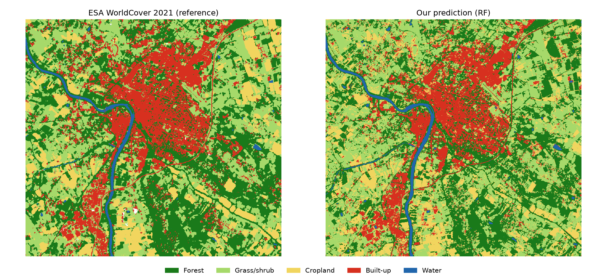
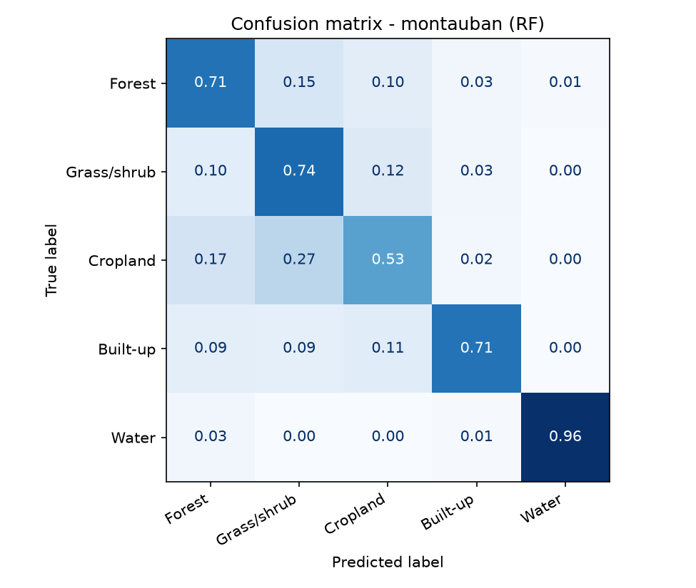
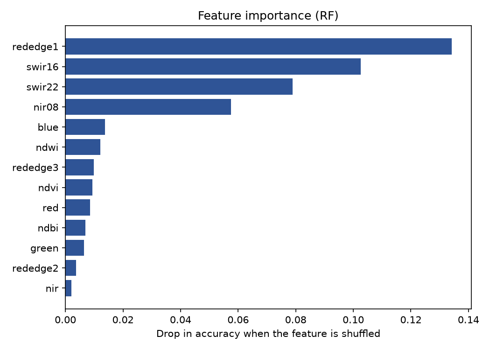

# Land-cover classification from Sentinel-2 with machine learning

Classify every 10 m pixel into **forest, grass/shrub, cropland, built-up or water** from free Sentinel-2 satellite images, using **ESA WorldCover 2021** as training labels. The model is trained on **Toulouse** and tested on **Montauban**, an area it has never seen, to measure how well it generalises.

## Results
| Model | Accuracy inside Toulouse (random 20 % split) | Overall accuracy (Montauban, unseen) | Macro F1 (Montauban) |
|---|---|---|---|
| Random Forest | 0.798 | **0.704** | 0.710 |
| Histogram Gradient Boosting | 0.801 | **0.708** | 0.714 |

Both areas use the same Sentinel-2 scene, `S2B_31TCJ_20210828_2_L2A` (28 August 2021, 0 % clouds). Most important features (permutation importance, RF): **rededge1 (B05), swir16 (B11), swir22 (B12)**.





**What I observed:** Accuracy drops from 0.80 inside Toulouse to 0.70 on Montauban, which shows why a separate test area matters. The weakest class is cropland (F1 0.45): 27 % of real cropland is predicted as grass/shrub and 17 % as forest, because by late August many fields are harvested or dry and look like grassland in a single image, while irrigated crops look like trees. Built-up recall is 0.71: in the city centre and suburbs a 10 m pixel mixes roofs with gardens and street trees, so it is often labelled vegetation. Some "errors" are label errors, since WorldCover itself is about 75 % accurate. The two models score almost the same, so the limit comes from the data (one summer date), not from the choice of algorithm.

## Method
1. **Data** (`step1_download.py`): searches the Earth Search STAC catalogue for the least cloudy Sentinel-2 L2A image (summer 2021), reads only the area of interest from Cloud-Optimized GeoTIFFs, resamples the 20 m bands to a common 10 m grid, masks clouds with the Scene Classification Layer, and reprojects the WorldCover labels onto the same grid. Earth Search already removes the −0.1 reflectance offset of recent processing baselines (`earthsearch:boa_offset_applied`), so the script does not apply it a second time (doing so gave negative reflectances and NDVI above 1).
2. **Features**: 10 spectral bands (B02–B08, B8A, B11, B12) + NDVI, NDWI and NDBI indices.
3. **Training** (`step2_train.py`): balanced sample of 4,000 pixels per class, Random Forest (200 trees), compared with Histogram Gradient Boosting; permutation feature importance.
4. **Evaluation** (`step3_evaluate.py`): spatial validation on a separate area, overall accuracy, per-class F1, confusion matrix and side-by-side maps.

## Run it
```bash
python -m venv venv
source venv/bin/activate          # Windows: venv\Scripts\activate
pip install -r requirements.txt
python step1_download.py toulouse
python step1_download.py montauban
python step2_train.py
python step3_evaluate.py
python step2_train.py --model hgb && python step3_evaluate.py --model hgb
```

## Limits and next steps
- WorldCover labels are themselves produced by a model (~75% accurate), so they contain errors.
- One summer image only: a time series (spring + summer + autumn) would separate crops from grassland better.
- Next: scale to the whole Haute-Garonne department with Dask, and compare 2017 vs 2025 to measure urban growth.

## Data
- Sentinel-2 L2A: Copernicus / ESA, via [Earth Search](https://earth-search.aws.element84.com/v1)
- ESA WorldCover 2021 v200: © ESA WorldCover project, CC BY 4.0
